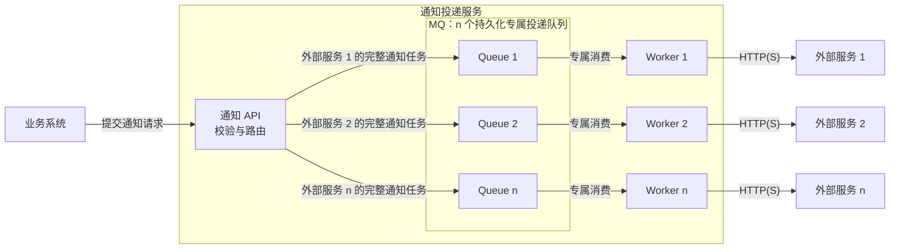

# 通知投递服务

## 系统目标

为内部业务系统提供统一的 HTTP(S) 通知投递能力。业务系统提交待发送的请求，由通知投递服务负责异步发送、失败重试及投递日志，降低外部 API 不稳定对业务流程的影响。

服务面向成熟业务系统接入，按生产环境要求设计可靠性、接口契约和运维能力。MVP 用于收敛首版功能范围，基础可靠性和集成要求仍应落实。

## 设计原则

- 作为系统中的基础服务，复用接入环境已有的消息队列、身份认证、配置管理和监控设施。
- 完整通知任务由 MQ 持久化，服务无需将消息另存数据库，也不设置任务数据库或 Outbox。
- 明确成功接收后的责任：消息已可靠入队，消费异常可恢复，最终失败可通过 MQ 运维设施排查和处理。
- 支持多个 API 实例部署，按外部服务分别部署专属 Worker，避免依赖单进程内存保存任务或协调执行。
- 基础机制与供应商业务逻辑分离，保持稳定的通知接口和清晰的集成边界。

## 整体架构

图中展示第 1、第 2 和第 n 条投递链路，其余链路省略。每个外部服务独享一个投递队列和一个 Worker。重试、死信所需的辅助队列或原生机制按 MQ 选型配置，并保持外部服务之间的隔离。

- **业务系统**：提供稳定的通知 ID、外部服务标识及完整 HTTP 请求，包括地址、方法、Header 和 Body。通知重试时复用同一通知 ID。
- **通知 API**：认证调用方、校验请求，按外部服务标识发布完整任务；确认消息已路由到目标队列并可靠入队后，返回接收成功和通知 ID。
- **消息队列**：持久化完整任务及重试元数据，承担缓冲、分发、消费确认和异常重新投递；多个逻辑队列可由同一 MQ 集群承载。
- **Workers**：每个外部服务对应一个专属 Worker，只消费该服务的专属队列，直接使用消息中的请求参数调用外部 API，处理失败并输出结构化日志和指标。

对任意外部服务 i，投递链路固定为 `Queue i → Worker i → 外部服务 i`。一条通知只进入目标服务对应的队列，失败重试仍回到同一队列。新增外部服务时，增加对应的队列、Worker 和路由配置。

消息包含通知 ID、调用方、外部服务标识、完整 HTTP 请求及创建时间等信息；重试次数、重试期限等随消息或 MQ 元数据保留。Worker 执行投递无需查询业务数据或任务数据库。

## 处理流程

1. 业务系统提交通知 ID、外部服务标识和完整 HTTP 请求，通知 API 校验服务标识、目标地址、消息大小与路由配置。
2. 通知 API 向该服务的专属队列发布持久化消息，等待发布确认并检查路由结果。消息已可靠入队后才返回接收成功。
3. MQ 不可用、明确发布失败或路由失败时，不返回接收成功；发布确认超时表示结果不确定，调用方可复用通知 ID 重试，可能产生重复消息。
4. 专属 Worker 消费消息并调用对应外部 API。第一版以 HTTP 2xx 为投递成功依据，成功后记录日志并确认消费。
5. 可恢复失败通过 MQ 的延迟重试能力或配套重试队列安排重试，更新重试元数据，到期后由同一专属 Worker 再次处理。
6. 永久失败或超过重试次数、期限时，将完整消息及失败原因保留到该服务对应的死信队列，输出日志和告警，供受控重投。

重试或转入死信时，必须先确保后续消息已可靠保留，再确认原消息；使用 MQ 原生转移机制时，需要验证其具备同等可靠性。发布确认不确定时保留原消息，允许重复，避免先确认再发布造成丢失。

## 生产环境基础要求

- **持久化与恢复**：使用支持持久化及高可用的队列，结合持久化消息、发布确认、路由校验和手动消费确认。Worker 异常退出后，依靠 MQ 恢复未确认消息。
- **失败控制**：按错误分类重试，采用带抖动的退避策略，设置连接和请求超时。重试次数、期限及并发上限可配置；异常重新投递也需要计数和上限，防止消息无限循环。
- **容量与隔离**：各外部服务使用独立队列与 Worker，分别控制投递并发和速率，并按调用方限制接入请求量，避免单个供应商故障占满全部处理能力；任务积压超过承载上限时实施接入限流。
- **可观测性**：贯通通知 ID、调用方、外部服务标识和链路标识，向已有日志平台输出各次投递结果，按队列及外部服务提供积压量、等待时间、投递延迟、成功率和重试量等指标及告警接入点。
- **访问与数据保护**：复用调用方认证，限制 MQ 访问和死信重投权限；限制目标域名、端口及实际连接 IP，默认不自动跟随重定向，按接入环境配置出站访问策略。消息中的敏感数据按环境策略保护，日志默认不记录鉴权凭据和请求正文。
- **部署集成**：配置外置，提供健康检查、就绪检查和优雅停机，明确队列容量及死信保留策略。容量达到上限时限制接入，避免静默丢弃已接收消息；优雅停机停止领取新消息，并处理或交还未确认消息。

## 可靠性与系统边界

- 接收成功表示完整消息已由目标 MQ 队列可靠接收，投递成功表示外部 API 返回成功状态。MQ 不可用时接收接口返回失败，由调用方保留通知并重试提交。
- 队列分发采用至少一次语义，允许重复。发布确认超时、Worker 宕机、重试转移以及外部 HTTP 超时，都可能导致重复投递。
- 通知 ID 用于关联投递日志及配合接收方实现幂等；相同 ID 的重复提交仍可能重复入队。服务首版不持久化跨请求去重记录，接收方业务幂等由调用方与接收方配合实现。
- 外部投递采用有限自动重试和失败保留，不承诺目标永久不可用时仍能送达，也不承诺严格只执行一次或按顺序投递。
- 服务负责通知的投递过程；业务系统负责供应商请求格式及业务含义，接收方负责具体业务处理。
- 服务责任从成功接收消息开始，业务状态提交与通知提交之间的一致性由业务系统负责。
- 服务不维护任务历史数据库，不提供逐条任务历史状态查询接口；投递排查依托日志和链路平台，失败消息查看及重投依托 MQ 运维设施，权限和操作记录接入已有运维审计能力。
- 第一版不处理业务事件订阅、供应商格式转换和外部业务结果校验。认证、监控等能力接入已有设施，功能范围围绕提交、投递、重试及死信处理收敛。

## 首版验收方向

- MQ 不可用或消息无法路由时，接口不误报接收成功；发布确认超时或响应丢失后，调用方可按约定重试，重复风险有明确说明。
- MQ 重启、Worker 在投递前后退出、HTTP 超时及消息重复消费时，已接收消息可恢复或重复投递，具有明确的确认边界。
- 重试消息或死信消息发布失败时，原消息不会提前确认；失败转移和异常重新投递均有恢复或终止策略。
- 目标长期不可用时，重试有上限，其他目标仍能继续处理，死信可查看和受控重投。
- 能通过配置接入目标环境的 MQ、日志和监控设施，无需任务数据库即可完成正常投递与故障恢复。

具体 MQ 选型、重试与死信拓扑、容量目标、投递时延目标、重试参数和死信保留期限，在明确接入环境并完成相应验证后确定。

## 设计参考

- [RabbitMQ 可靠性与确认机制](https://www.rabbitmq.com/docs/reliability)
- [RabbitMQ 发布确认与消费确认](https://www.rabbitmq.com/docs/confirms)
- [RabbitMQ 死信与消息转移可靠性](https://www.rabbitmq.com/docs/dlx)
- [OWASP：出站请求与 SSRF 防护](https://cheatsheetseries.owasp.org/cheatsheets/Server_Side_Request_Forgery_Prevention_Cheat_Sheet.html)
